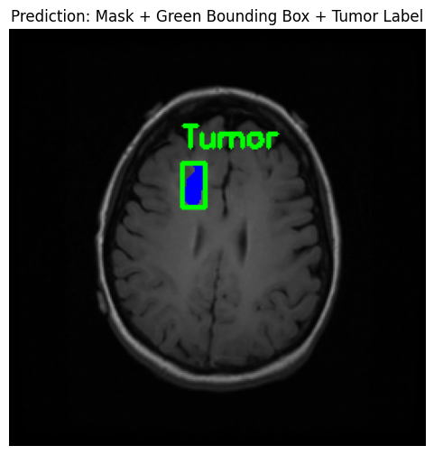
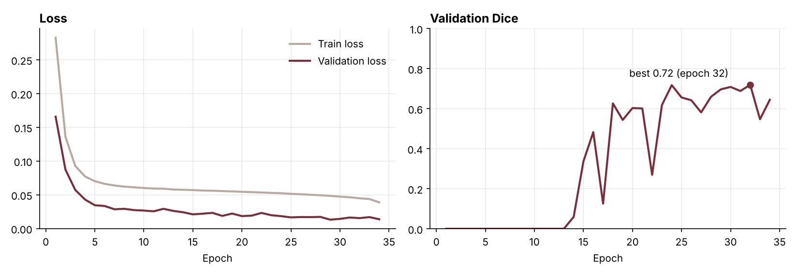
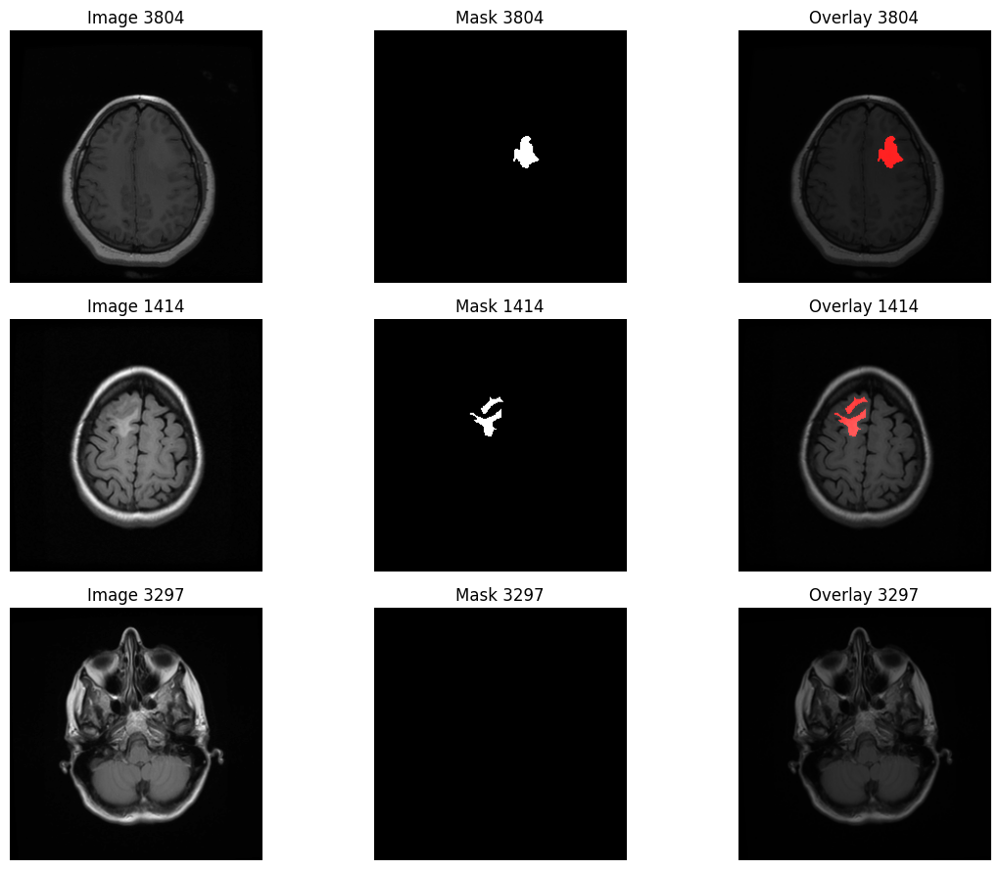

<div align="center">

# Brain Tumour Segmentation with U-Net

**Outlines low-grade glioma regions on brain MRI slices, pixel by pixel.**
Trained on Kaggle, deployed as a live web demo on Hugging Face.

[](https://huggingface.co/spaces/Anjali2034/Brain_tumor_deployment_model)
[](https://www.kaggle.com/code/anjali2034/modeldeployment)




</div>

---

## Results

Evaluated on a held-out test set of **590 MRI slices** the model never saw during training.

| Metric | Score |
|---|---|
| Mean Dice coefficient (per slice) | **0.84** |
| Mean IoU (per slice) | **0.81** |
| Precision (validation, pixel level) | 0.90 |
| Recall (validation, pixel level) | 0.71 |

> Per-slice scores include slices with no tumour, where an empty prediction counts as correct. Pixel-level scores look only at tumour pixels and are the stricter view.



Training stopped early at epoch 34 (patience 5); the best validation Dice was 0.72.

---

## How it works

```
MRI slice  ->  resize to 256x256, normalise  ->  U-Net  ->  per-pixel probability  ->  threshold 0.5  ->  mask + overlay
```

- **Model:** U-Net built from scratch in PyTorch. 4 encoder blocks (64 to 512 channels), a 1024-channel bottleneck, 4 decoder blocks with skip connections, sigmoid output.
- **Data:** [LGG MRI Segmentation](https://www.kaggle.com/datasets/mateuszbuda/lgg-mri-segmentation), 3,929 MRI slices (three sequences stacked as RGB) with expert masks from 110 patients (TCGA / TCIA).
- **Split:** 70 / 15 / 15, stratified so tumour and no-tumour slices are balanced in every split (2,750 / 589 / 590).
- **Class balance:** 961 tumour slices in the training set were augmented (flips, 90 degree rotations, brightness and contrast, shift, scale, rotate) to counter the many empty slices.
- **Training:** binary cross entropy loss, Adam (learning rate 1e-4, halved on plateau), batch size 8, up to 50 epochs with early stopping, on a Tesla T4 GPU.
- **Deployment:** Gradio app on Hugging Face Spaces, CPU inference.



---

## Repository structure

```
brain-tumor-segmentation/
├── notebook/
│   └── brain_tumor_segmentation.ipynb   # data prep, training, evaluation (Kaggle)
├── app/
│   ├── app.py                           # Gradio demo deployed on Hugging Face
│   ├── requirements.txt
│   └── examples/                        # sample MRI slices for one-click testing
├── assets/                              # figures used in this README
├── .gitignore
├── LICENSE
└── README.md
```

---

## Run it locally

```bash
git clone https://github.com/Anjali2034/brain_tumor_model_deployment.git
cd brain_tumor_model_deployment/app
pip install -r requirements.txt
```

Download the trained weights `best_model.pth` from the [Hugging Face Space files](https://huggingface.co/spaces/Anjali2034/Brain_tumor_deployment_model/tree/main) into `app/`, then:

```bash
python app.py
```

Open the local link it prints and try one of the sample scans.

> The weights are kept on Hugging Face, not in this repo, because the file is too large for GitHub.

---

## What I would improve next

- Report Dice on tumour slices only, alongside the overall score.
- Try a pretrained encoder (for example ResNet34 U-Net) to lift recall.
- Add Dice loss to the current BCE loss to handle the small tumour regions better.

---

<sub>Research project for learning purposes. Not a medical device and not for diagnosis. Dataset: Buda, Saha and Mazurowski (2019), via Kaggle.</sub>

**Anjali Verma** · [LinkedIn](https://www.linkedin.com/in/anjali-verma-66023a284/) · [GitHub](https://github.com/Anjali2034)
